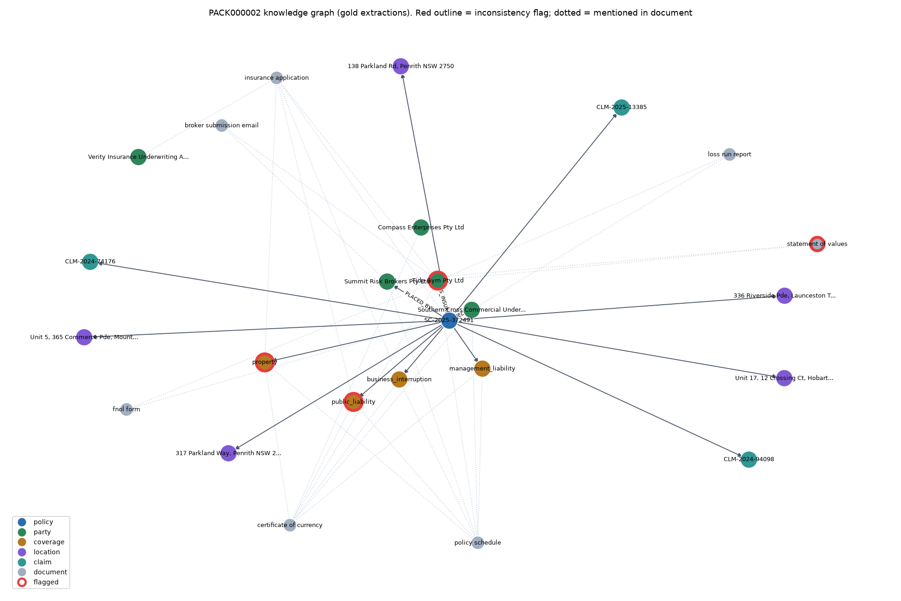

# InsurGraph: Insurance Document Intelligence

LLM extraction, knowledge graph, inconsistency detection and RAG over **synthetic** commercial
P&C insurance submission documents, with an evaluation harness for every step.

* Extract policyholders, insurers, brokers, policies, coverages (limits, deductibles), locations,
  claims and key dates into a validated Pydantic schema, with page provenance on every item.
* Compare 2 prompt strategies × 2 models from different vendors on a pack-level dev/test split.
* Resolve entity names across documents, load everything into a NetworkX knowledge graph and flag
  cross-document inconsistencies (limits, currencies, totals, ABN formats, loss dates, policy numbers).
* Answer questions with Chroma retrieval and measure hit rate, exact/numeric accuracy and LLM-judged
  free-text accuracy.


*Pack B graph built from the model's extractions. Red outlines are detector flags: the SOV total
mismatch and ABN formatting (labelled), two coverage-limit conflicts between the schedule and the
certificate of currency (real but unlabelled in the dataset), and one false policy-period flag
caused by a line-wrapped date. The second "policy" node `APP-PACK000002-5125` is an extraction
error (the application's export reference taken as a policy number, error type 1 below).*

## Results

All numbers are strict-match unless stated, with document-bootstrap 95% CIs and item counts in the
per-run tables (`runs/extraction/<split>/<config>/metrics.md`). **Dev** = Pack A + synthetic dev,
used for prompt writing, threshold tuning and model selection. **Test** = Pack B + synthetic test,
run once after the configuration was chosen (`runs/extraction/best_config.json`). Seven real
documents per split is a small sample: differences between configurations are within the CIs.

### Extraction (entity and relationship macro-F1)

| Split | Subset | Model | Prompt | Entity F1 [95% CI] | Relationship F1 [95% CI] |
|---|---|---|---|---|---|
| dev | Pack A (7 docs) | Gemini 3.5 Flash Lite | zero-shot | 0.971 [0.83, 1.00] | 0.888 [0.73, 1.00] |
| dev | Pack A | Gemini 3.5 Flash Lite | few-shot | 0.961 [0.87, 1.00] | 0.888 [0.73, 1.00] |
| dev | Pack A | gpt-oss-120b (Groq) | zero-shot | 0.918 [0.83, 0.98] | 0.958 [0.88, 1.00] |
| dev | Pack A | gpt-oss-120b (Groq) | few-shot | 0.894 [0.79, 0.96] | 0.958 [0.88, 1.00] |
| dev | synthetic (12 docs) | Gemini 3.5 Flash Lite | zero-shot | 0.967 [0.92, 0.99] | 1.000 |
| dev | synthetic | Gemini 3.5 Flash Lite | few-shot | 1.000 | 1.000 |
| dev | synthetic | gpt-oss-120b | zero-shot | 0.957 [0.91, 0.99] | 0.967 [0.92, 1.00] |
| dev | synthetic | gpt-oss-120b | few-shot | 0.935 [0.88, 0.98] | 0.952 [0.87, 0.98] |
| **test** | **Pack B (7 docs)** | **Gemini 3.5 Flash Lite** | **few-shot (selected)** | **0.933 [0.87, 0.97]** | **0.906 [0.73, 1.00]** |
| test | Pack B | Gemini 3.5 Flash Lite | zero-shot | 0.918 [0.81, 0.96] | 0.906 [0.73, 1.00] |
| test | Pack B | gpt-oss-120b | zero-shot | 0.870 [0.73, 0.96] | 0.881 [0.75, 1.00] |
| test | Pack B | gpt-oss-120b | few-shot | 0.916 [0.81, 1.00] | 1.000 |
| **test** | **synthetic (12 docs)** | **Gemini 3.5 Flash Lite** | **few-shot (selected)** | **0.968 [0.90, 1.00]** | **1.000** |
| test | synthetic | Gemini 3.5 Flash Lite | zero-shot | 0.925 [0.83, 0.99] | 0.971 [0.92, 1.00] |
| test | synthetic | gpt-oss-120b | zero-shot | 0.978 [0.94, 0.99] | 0.962 [0.91, 0.99] |
| test | synthetic | gpt-oss-120b | few-shot | 0.891 [0.80, 0.99] | 0.962 [0.91, 0.99] |

Selection rule (fixed before the test run): mean of entity and relationship macro-F1 over the two
dev subsets. Lenient matching (fuzzy names/addresses) equals strict on the real packs and adds up to
+0.04 for gpt-oss on synthetic documents. All 152 document extractions returned schema-valid JSON;
11 needed the one validation retry, none were salvaged. Full table with lenient scores and token
counts: `runs/summary.md`.

### Inconsistency detector

Labelled flags = the dataset's 4 engineered inconsistencies + 10 programmatically seeded ones in the
synthetic packs. Raw counts, because there are too few cases for a meaningful percentage.

| Input | Split | Labelled found / missed | Extra: true (unlabelled) | Extra: corroborating | Extra: false |
|---|---|---|---|---|---|
| Gold extractions (detector logic alone) | dev | 7 / 0 | 0 | 1 | 0 |
| Gold extractions | test | 7 / 0 | 2 | 0 | 0 |
| Gemini few-shot extractions (end to end) | dev | 7 / 0 | 0 | 1 | 2 |
| Gemini few-shot extractions (end to end) | test | 7 / 0 | 2 | 0 | 2 |

Worked examples (Pack A / Pack B, end to end):

| Pack | Flag | How it was found |
|---|---|---|
| A | `currency_mismatch` (labelled) | SOV location #1 total printed as `USD $3,413,719`; every other amount in the pack is AUD |
| A | `loss_date_outside_policy_period` (labelled) | Loss run shows CLM-2020-27293 lost 13/10/2027, after it was reported (02/10/2020) and after the valuation date; the application declares 24/09/2020 for the same claim (corroborating conflict) |
| B | `sov_total_mismatch` (labelled) | SOV displayed total 15,383,103 ≠ sum of the 5 rows 14,635,928 |
| B | `abn_formatting_inconsistency` (labelled) | Same ABN printed `21275287720` on the SOV and `21 275 287 720` elsewhere |
| B | `limit_mismatch` ×2 (true, **not labelled in the dataset**) | Schedule: Public Liability 10M, Property 2M; certificate of currency: 20M and 1M |
| A, B | `policy_number_mismatch` (false) | Extraction error: application export reference taken as a policy number |
| A | `claim_attribute_mismatch` (false) | Extraction error: claim report date taken as the claim's reported date |
| B | `policy_period_mismatch` (false) | Extraction error: line-wrapped SOV end date read as 2026-12-26 |

Every false flag traces back to an extraction error (see the error analysis); on gold extractions
the detector raises none. Details: `runs/detector/results.md`.

### Entity resolution

| Resolver | Dev pairs (14) accuracy | Test pairs (14) accuracy |
|---|---|---|
| normalise + fuzzy (token-set ratio, threshold tuned on dev) | 1.00 | 0.86 (2 false negatives) |
| normalise + fuzzy + Gemini `is_same_entity` for grey-zone pairs | 1.00 | 1.00 |

The two string-matching failures are `Southern Cross Commercial Underwriters Pty Ltd` vs
`... Underwriting` and `Zurich North America` vs `Zurich American Insurance Company`. Hard negatives
such as `Pinewood Insurance Underwriting Agency` vs `Verity Insurance Underwriting Agency` stay apart.

### RAG (28 questions with known answers, 14 per pack)

| Split | Variant | Retrieval hit@5 | Exact/numeric acc. (n=11) | Judged free-text acc. (n=3) | Overall |
|---|---|---|---|---|---|
| dev (Pack A) | plain | 0.93 | 0.91 | 0.67 | 0.86 |
| dev (Pack A) | graph-routed | 0.93 | 0.91 | 0.33 | 0.79 |
| test (Pack B) | plain | 1.00 | 0.91 | 0.33 | 0.79 |
| test (Pack B) | graph-routed | 1.00 | 0.91 | 0.67 | 0.86 |

Answers by Gemini 3.5 Flash Lite over the top-5 chunks (local `all-MiniLM-L6-v2` embeddings in
Chroma). Numeric, date and name answers are scored without a judge; free-text answers are judged
by Groq `qwen/qwen3.8-27b` (a different model family from both extractors). All 12 judge decisions
were checked by hand: 12/12 agreement (`data/gold/judge_manual_check.json`). Most failures are
"not found" although the right document was retrieved: hit@k is document-level and the chunk with
the answer (e.g. the SOV totals row) was not in the top 5. With 3 free-text questions per split, the
plain vs graph-routed difference is one question either way.

## Error analysis (summary)

1. **Relationships invented for documents without a policy number:** Gemini links the application's
   export reference to the insured, coverages and claims (all 8 spurious Pack B relationships).
2. **PDF line-wrap damage in table cells:** `CLM-2024` / `-74176`, `Motor` / `Collision`, and
   `01/12/20` / `26` produce missed claims, truncated categories and a wrong date.
3. **Date semantics across document types:** the claim report's own date is taken as the claim's
   reported date by every configuration; a synthetic template's `A$` was copied as the currency
   instead of `AUD` (a normalisation gap found on test and deliberately left unpatched).

Full write-up with counts and examples: [docs/error_analysis.md](docs/error_analysis.md).

## Data, licence and label provenance

* **Documents:** RCA Insurance Library 2-pack preview
  ([RootCauseAnalytics/Insurance-Library-Sample](https://huggingface.co/datasets/RootCauseAnalytics/Insurance-Library-Sample)),
  **CC-BY-NC-4.0, fully synthetic, non-commercial use only**. 14 PDFs in 2 submission packs with
  4 engineered cross-document inconsistencies. The raw files are included in `data/raw/` with
  their original README; `scripts/download_data.py` re-downloads them.
* **Synthetic packs (Gate 1 fallback):** 6 packs / 24 PDFs generated by `src/synth.py` from fact
  records with code templates (no LLM), so labels are correct by construction. Dev and test use
  disjoint template styles and seeds. Reason: Pack B alone gives fewer than 10 gold items for several
  entity types and shares templates with Pack A ([docs/phase0_data_note.md](docs/phase0_data_note.md)).
* **Gold set (`data/gold/gold.jsonl`, 179 items on the real documents):**
  116 items converted from the dataset ground truth, using only the fields each template actually
  prints and applying the engineered overrides (`src/gold.py`); **63 hand-labelled items**
  (`data/gold/hand_labels.json`): all 54 relationships (the dataset has none), the applications'
  declared-claims tables (7 claims) and the SOV "declared as at" dates. Hand-labelled name pairs for
  entity resolution (`entity_pairs.json`), the RAG question set (`rag_questions.json`) and the list of
  real but unlabelled inconsistencies (`unlabelled_inconsistencies.json`) are also in `data/gold/`.

## How it works

See [docs/architecture.md](docs/architecture.md) for the diagram.

```
src/      schema.py  normalize.py  ingest.py  extract.py  llm.py  resolve.py  graph.py  rag.py  synth.py  gold.py
          eval/ matching.py  metrics.py  report.py  detector.py  rag_eval.py
prompts/  extract_zero_shot_v1.md  extract_few_shot_v1.md
data/     raw/  gold/  synthetic/
runs/     phase0/  thin_slice/  extraction/  resolution/  detector/  rag/  error_analysis/  summary.md
scripts/  download_data.py  phase0_inspect.py  thin_slice.py  tune_resolution.py  run_all.py  error_analysis.py  plot_graph.py
tests/
```

* **Ingestion:** plain PyMuPDF text with page markers. It kept the SOV and loss-run tables intact
  better than `pymupdf4llm`, whose table detection split cells across columns (Phase 0 note).
* **Extraction:** one request per document (all are under 1K tokens). Output is a compact row-array
  JSON format, about 3× fewer output tokens than verbose objects, which matters under Groq's 8K TPM.
  It is converted to the schema, validated with Pydantic, and retried once with the validation
  error. Temperature 0.
* **LLM client (`src/llm.py`):** Gemini, Groq and any OpenAI-compatible local server (LM Studio)
  behind one call. It has a persistent `diskcache` keyed on provider, model, prompt, parameters and
  schema version, and a proactive sliding-window token/request limiter. `tenacity` backoff honours
  `retry-after`. Optional `*_API_KEY_FALLBACK` keys take over automatically on HTTP 429.
  `instructor` was not needed: native JSON mode plus Pydantic validation was enough.
* **Evaluation:** items are normalised (ISO dates, numeric money, company suffixes stripped,
  canonical coverage names), then matched 1:1 on a key. A true positive needs every field to agree.
  Strict and lenient (fuzzy names and addresses) modes. Per-type P/R/F1 with counts and field
  accuracy, macro and micro averages, and bootstrap CIs. Types with fewer than 10 gold items are
  flagged.

## Reproduce

```bash
python -m venv venv && source venv/bin/activate
pip install -r requirements.txt
cp .env.example .env    # add GEMINI_API_KEY and GROQ_API_KEY (free tier)
python scripts/run_all.py            # full pipeline: about 150 extraction calls, ~10 min Gemini, ~40 min Groq
python scripts/run_all.py --offline  # rebuild every table from the committed runs/ outputs, no API calls
pytest
```

The final run outputs (predictions, logs, metrics, flags, RAG answers) are committed in `runs/`, and
`runs/summary.md` is the generated results summary. The LLM cache (`cache/`) and `.env` are
git-ignored. Calls use temperature 0, but hosted models are not guaranteed to be deterministic, so a
fresh full run can differ slightly; `--offline` reproduces the tables exactly. Without a
`GEMINI_API_KEY`, entity resolution falls back to its string layers (logged in
`runs/detector/resolution_log_best.json`); on the committed extractions this changes no decision.

**Free-tier budget used for the reported run** (successful calls, from the cache): ~245K tokens on
Gemini over 141 calls (extraction, RAG, entity resolution) and ~164K tokens on Groq over 92 calls
(gpt-oss-120b extraction plus the Qwen judge), under Groq's 200K/day cap. Few-shot costs about 50%
more tokens than zero-shot.

## Limitations

* **Small sample.** There are 7 real documents per split and 14 labelled inconsistencies in total.
  CIs are wide and no configuration difference is significant. The synthetic packs add volume but
  come from simple code templates, which are easier than real documents.
* **Hand labels are single-annotator.** The relationships and the extra claims were labelled by one
  person and were not double-checked.
* **Same model for answering and extraction.** The judge is a different model family from both
  extractors, but the RAG answer model is the same as the selected extractor.
* **Detector scope.** The detector covers the attribute conflicts and rules listed above. Conflicts
  outside the schema are not detected, such as "years trading" (25 vs 17 in Pack A, 15 vs 29 in
  Pack B).
* **Model coverage.** Only the clean PDFs were used; the scanned variants (an OCR test) and the
  stretch items (gpt-oss-20b ablation, local-model run, Streamlit demo) were not run.
